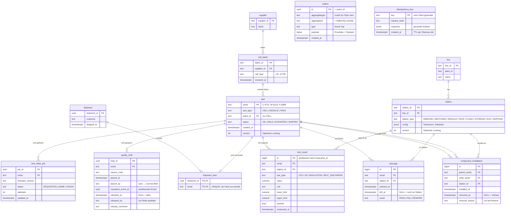
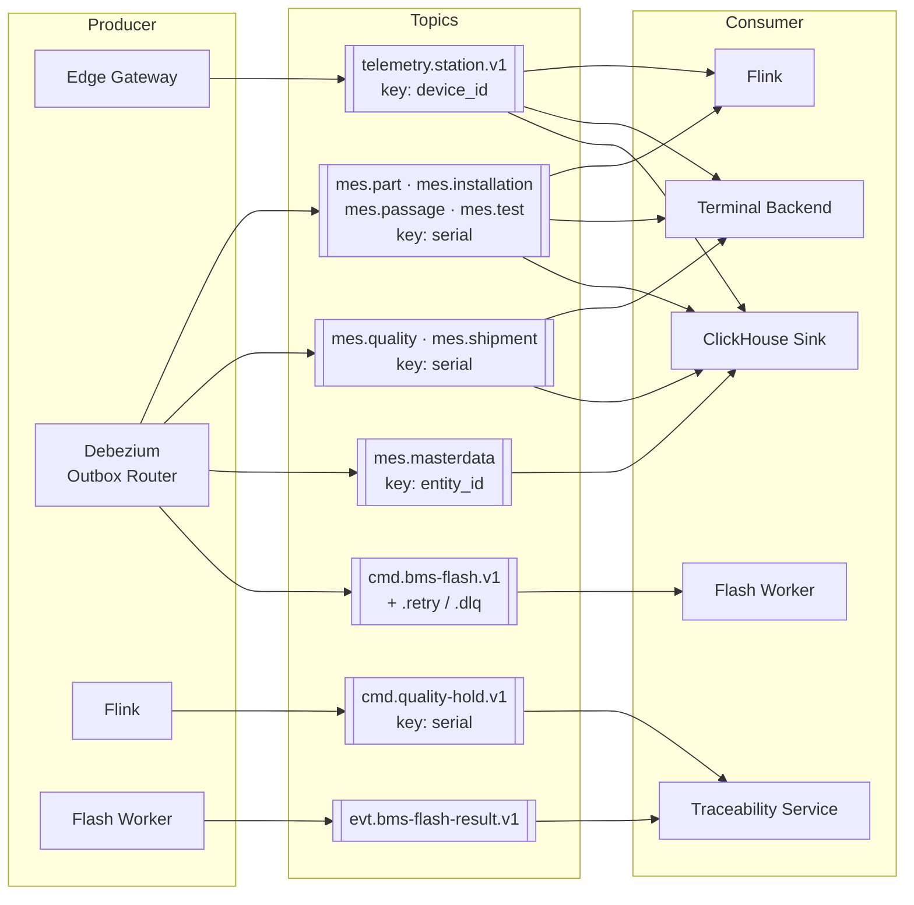
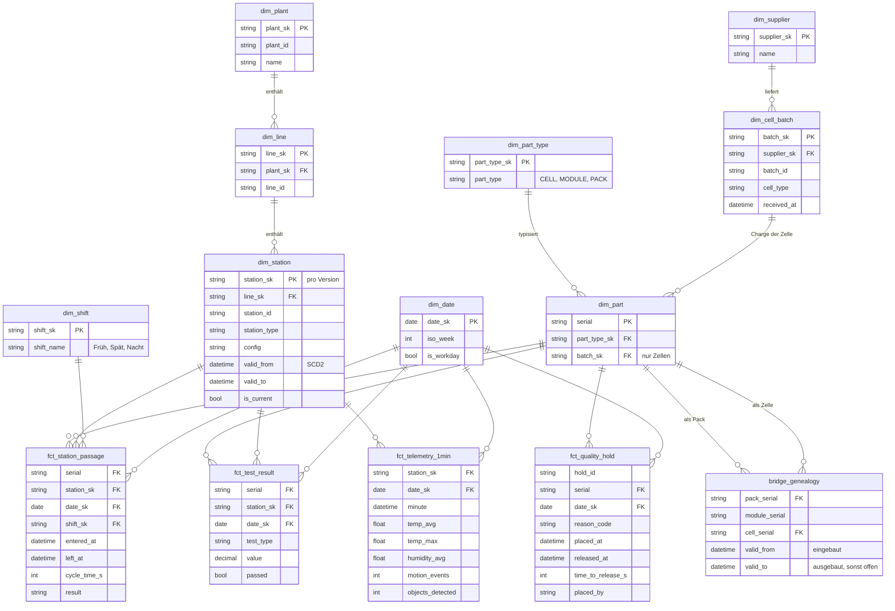

# CellTrace – Datenmodelle

Drei Modelle, drei Zwecke:

| Modell | Zweck | Quelle der Wahrheit |
|---|---|---|
| 1. OLTP (Postgres) | Schreiben: konsistent, schnell, rückverfolgbar | Traceability Service |
| 2. Event-Katalog | Öffentlicher Vertrag zwischen allen Komponenten | Avro-Schemas in `schemas/` |
| 3. OLAP (ClickHouse) | Lesen: Analyse, OEE, Rückruf | dbt-Modelle in `warehouse/dbt/` |

> 💬 *Interview:* "Das OLTP-Modell ist privat und darf sich ändern. Der Event-Katalog ist der Vertrag. Das Warehouse kennt nur Events, nie Tabellen."

---

## 1. OLTP-Modell (Postgres)



`outbox` und `idempotency_key` sind technische Tabellen ohne Beziehungen zu den anderen.

**Constraints, die die DB erzwingt (nicht der Code):**

```sql
-- Ein Child steckt nie in zwei Parents gleichzeitig
CREATE UNIQUE INDEX ux_one_active_parent
  ON component_installation (child_serial) WHERE removed_at IS NULL;

-- Höchstens eine aktive Sperre pro Teil
CREATE UNIQUE INDEX ux_one_active_hold
  ON quality_hold (serial) WHERE released_at IS NULL;

-- Ausbau nicht vor Einbau
ALTER TABLE component_installation
  ADD CHECK (removed_at IS NULL OR removed_at >= installed_at);

-- Ein Teil ist höchstens einmal gleichzeitig an einer Station
CREATE UNIQUE INDEX ux_one_open_passage
  ON passage (serial) WHERE left_at IS NULL;
```

**Designentscheidungen:**
- **`part` als eine Tabelle für alle Ebenen** statt `cell`, `module`, `pack`: Die Genealogie wird damit eine einzige selbstreferenzierende Struktur. Ebenenregeln (Zelle nur in Modul, Modul nur in Pack) prüft der Service.
- **`part.status` ist denormalisiert** (eigentlich aus `quality_hold` und `shipment_item` ableitbar). Er dient dem Hot Path: "Darf dieser Pack weiter?" ist eine Primärschlüssel-Abfrage statt eines Joins. Der Status wird in derselben Transaktion gepflegt wie die Quelle.
- **Kein gesperrter Pack wird versendet:** Der Versand liest `part` mit `version` und setzt `SHIPPED` nur, wenn sich `version` nicht geändert hat (Optimistic Locking). Setzt Flink parallel eine Sperre, schlägt einer von beiden fehl und wiederholt den Vorgang.
- **`test_result` wird nach Zeit partitioniert**, weil sie die mit Abstand größte Tabelle ist. Alte Partitionen können günstig archiviert werden.
- **`outbox` folgt den Spaltennamen des Debezium Outbox Event Routers** (`aggregatetype`, `aggregateid`, `type`, `payload`), sodass keine Mapping-Konfiguration nötig ist.

---

## 2. Event-Katalog (Data Contracts)

**Fluss: Producer → Topic → Consumer**



**Schemas: Envelope + Payloads**

```mermaid
classDiagram
    class Envelope {
        uuid event_id
        string event_type
        int schema_version
        timestamp occurred_at
        uuid correlation_id
        uuid causation_id
        string producer
        string actor
        Payload payload
    }
    class TelemetryRecorded {
        string device_id
        string station_id
        long seq_no
        float temperature_c
        float humidity_pct
        float distance_cm
        boolean motion_detected
    }
    class ComponentInstalled {
        string parent_serial
        string child_serial
        string station_id
    }
    class ComponentRemoved {
        string parent_serial
        string child_serial
        string removal_reason
    }
    class StationEntered {
        string serial
        string station_id
    }
    class StationLeft {
        string serial
        string station_id
        string result
    }
    class TestResultRecorded {
        string serial
        string station_id
        string test_type
        decimal value
        decimal lower_limit
        decimal upper_limit
        boolean passed
    }
    class QualityHoldRequested {
        string serial
        string reason_code
        timestamp window_start
        timestamp window_end
    }
    class QualityHoldPlaced {
        uuid hold_id
        string serial
        string reason_code
    }
    class QualityHoldReleased {
        uuid hold_id
        string serial
        string release_comment
    }
    class PackShipped {
        uuid shipment_id
        string serial
        string customer
    }
    class StationConfigChanged {
        string station_id
        string line_id
        string station_type
        string config_json
    }
    Envelope *-- TelemetryRecorded
    Envelope *-- ComponentInstalled
    Envelope *-- ComponentRemoved
    Envelope *-- StationEntered
    Envelope *-- StationLeft
    Envelope *-- TestResultRecorded
    Envelope *-- QualityHoldRequested
    Envelope *-- QualityHoldPlaced
    Envelope *-- QualityHoldReleased
    Envelope *-- PackShipped
    Envelope *-- StationConfigChanged
```



Nicht dargestellt, gleiches Muster: `PartRegistered`, `BmsFlashRequested`, `BmsFlashCompleted`, `BatchReceived`.

**Phase 0 braucht nur:** `TelemetryRecorded`, `StationEntered`/`StationLeft`, `QualityHoldRequested`, `QualityHoldPlaced`.

**Designentscheidungen:**
- **Kafka-Key = `serial`** für alle `mes.*`-Topics: Alle Events eines Teils landen in derselben Partition und kommen **in Reihenfolge** an. `StationLeft` kann so nie vor `StationEntered` verarbeitet werden.
- **Telemetrie-Key = `device_id`**: Die Reihenfolge pro Sensor bleibt erhalten, was die Deduplizierung über `seq_no` vereinfacht.
- **Commands im Imperativ-Präfix `cmd.`, Events in der Vergangenheitsform**: `QualityHoldRequested` ist eine Bitte, `QualityHoldPlaced` eine Tatsache. Am Namen ist erkennbar, wer entscheidet.
- **Version im Topic-Namen nur bei Breaking Changes** (`.v1` → `.v2`). Kompatible Änderungen laufen über die Schema Registry (`BACKWARD`).
- **`mes.masterdata`** für Stammdaten (Station, Charge, Lieferant) ist die Grundlage für SCD2 im Warehouse.

---

## 3. OLAP-Modell (ClickHouse, Snowflake-Core)



**Rückruf-Query im OLAP (ohne Rekursion):**

```sql
SELECT DISTINCT g.pack_serial
FROM bridge_genealogy g
JOIN dim_part c        ON c.serial = g.cell_serial
JOIN dim_cell_batch b  ON b.batch_sk = c.batch_sk
JOIN fct_station_passage s ON s.serial = g.pack_serial   -- Versandstation
WHERE b.batch_id = 'B-2026-117'
  AND s.station_sk IN (SELECT station_sk FROM dim_station WHERE station_type = 'SHIPPING')
  AND s.entered_at >= g.valid_from
  AND (g.valid_to IS NULL OR s.entered_at < g.valid_to);
```

**Designentscheidungen:**
- **Snowflake im Core, flach in den Marts:** Die Hierarchie Station → Linie → Werk bleibt normalisiert und pflegbar. Für Dashboards baut dbt flache Marts, z. B. `mart_oee_shift` (Station, Linie, Schicht, Verfügbarkeit, Leistung, Qualität, OEE in einer Zeile), weil ClickHouse breite Tabellen deutlich schneller liest als Joins.
- **Surrogate Keys (`_sk`) nur dort, wo SCD2 nötig ist oder IDs instabil sein könnten.** `dim_part` nutzt die Seriennummer direkt, weil sie fachlich eindeutig und unveränderlich ist.
- **SCD2 in `dim_station` aus `StationConfigChanged`-Events:** Eine Toleranzänderung an Station 6 ist historisch korrekt zugeordnet. "Warum wurde am 12.03. gesperrt?" wird mit der damals gültigen Toleranz beantwortet.
- **`bridge_genealogy` löst die OLTP-Rekursion einmal in dbt auf**, sodass der Rückruf ein einfacher Join wird.
- **`fct_telemetry_1min` statt Rohdaten im Core:** Die Rohtelemetrie bleibt in `raw_*` (mit TTL), aggregiert pro Minute speist sie die Analyse. Echtzeit-Aggregate für Grafana kommen aus einer ClickHouse-Materialized-View.
